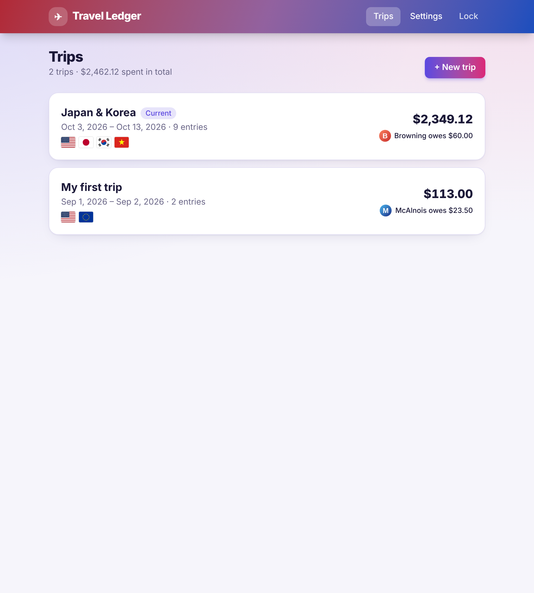
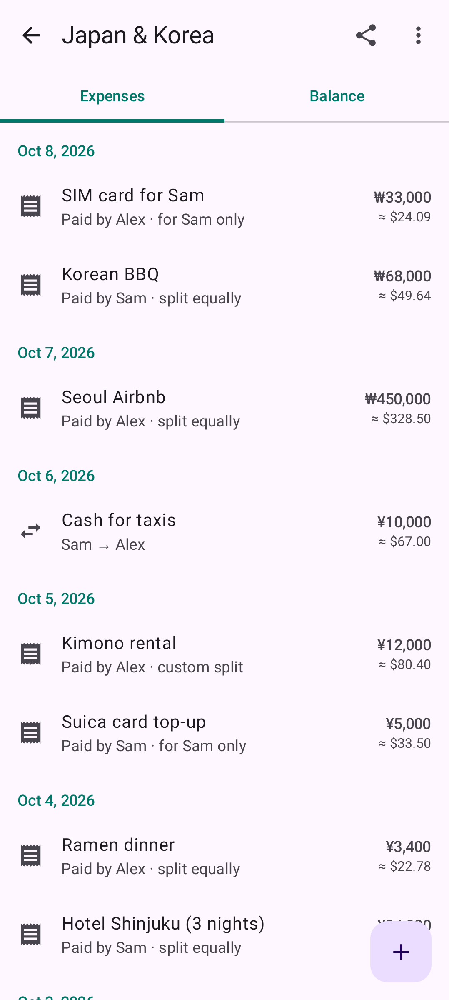
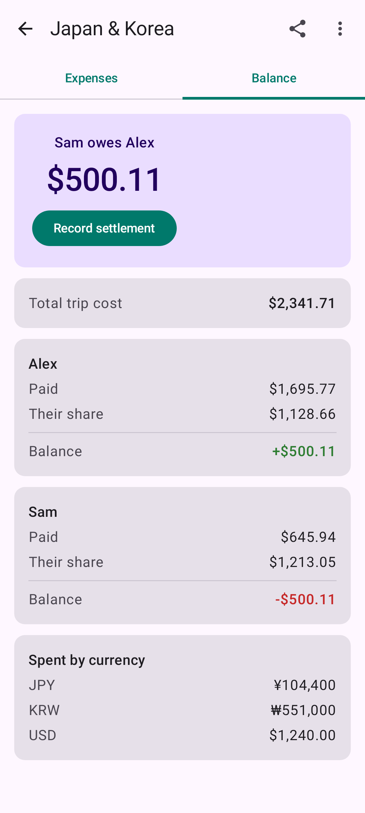
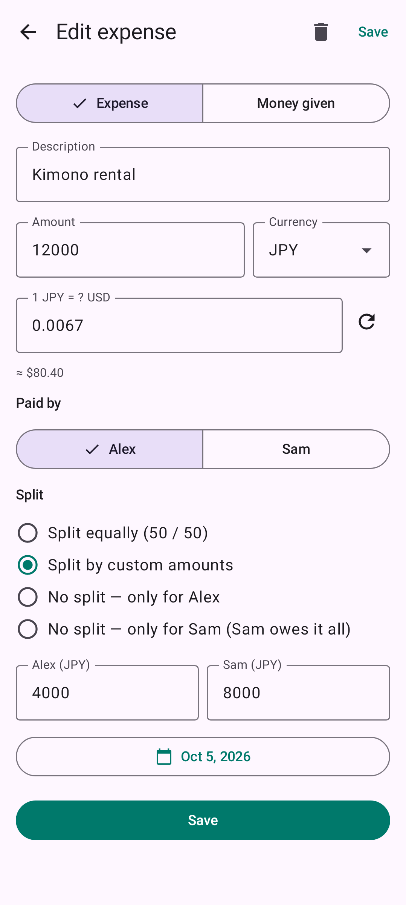
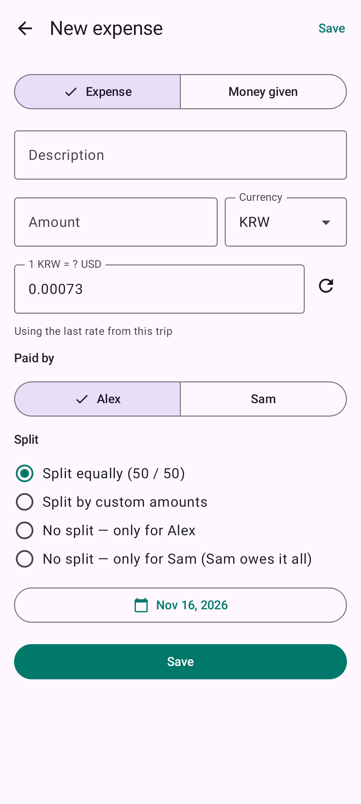
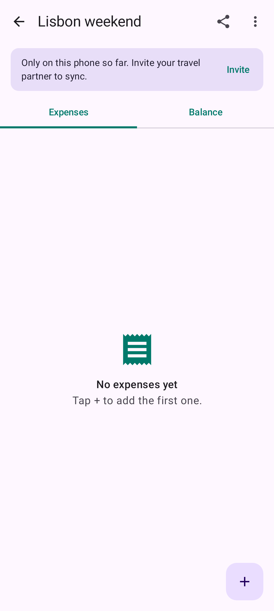

# TravelSplit

An Android app for tracking shared travel expenses between two people, similar to Tricount.

## Screenshots

| Trips | Expenses | Balance | Expense (custom split) |
|---|---|---|---|
|  |  |  |  |

| New expense | Invite partner | New trip |
|---|---|---|
|  |  |  |

These are generated from the real UI with sample data by `ScreenshotTest` (`./gradlew :app:recordRoborazziDebug`)
and updated automatically by CI.

## Features

- **Trips**: each trip has two people and a main currency that balances are shown in.
- **Any currency**: record each expense in the currency you paid in. The exchange rate is filled in automatically:
  the last rate you used for that currency on the trip, or otherwise the latest
  [ECB reference rate](https://frankfurter.app) (about 30 major currencies). You can always edit it by hand,
  so the app works offline. The rate is saved with each expense, so later rate changes don't alter past balances.
- **Split options** for each expense:
  - Split equally (50/50)
  - Split by custom amounts
  - No split: only for the payer (tracked in the totals, nobody owes anything)
  - No split: only for the other person (they owe the full amount)
- **Money given**: record cash handed over or a repayment between the two people.
- **Balance**: who owes whom, total trip cost, what each person paid, each person's share, and spending per currency.
  "Record settlement" adds the repayment that brings the balance to zero.
- **Share**: send a plain-text summary of the trip and all its expenses.
- **Sync between two phones**: invite your travel partner from the trip's menu. They tap **Join trip** and paste
  the code, and from then on both phones see the same trip, updated live. The app also works offline: changes are
  saved on the phone right away and sync when it's back online. No account or sign-up is needed: each install
  signs in anonymously in the background.

## Firebase setup (one-time, required for sync)

Sync uses Google Firebase (Cloud Firestore). The free tier is far more than two people need.

1. Go to the [Firebase console](https://console.firebase.google.com) and create a project (Google Analytics isn't needed).
2. **Add an Android app** to the project with package name `com.travelsplit.app`.
   Download the `google-services.json` it gives you and put it in the `app/` folder.
3. **Build → Authentication → Get started → Sign-in method**: enable **Anonymous**.
4. **Build → Firestore Database → Create database** (any location, start in production mode).
   Then open the **Rules** tab, replace the contents with [`firestore.rules`](firestore.rules) from this repo, and click **Publish**.
5. Commit `app/google-services.json` so the GitHub Actions build produces a working APK.
   This file isn't secret: it only identifies your Firebase project. Access to the data is controlled by the rules above.

Without step 2, CI still builds the app with a placeholder config to check that the code compiles, but that APK can't sync.

### How sharing works

Each trip is a Firestore document with a random 20-character ID. That ID is the trip code. Anyone signed in who
has the code can join the trip, and only members can read or change its expenses (see `firestore.rules`).

## Project structure

| Module | What it contains |
|---|---|
| `core/` | Pure Kotlin: the split and balance math, money rounding and parsing. Unit tested, no Android dependency. |
| `app/`  | The Android app: Jetpack Compose UI (Material 3), Firestore sync with offline cache, exchange-rate fetching. |

Amounts are stored as exact decimals (`BigDecimal`) and rounded to each currency's own number of decimals
(for example 0 for JPY), so there are no floating-point errors.

## Building

Requirements: JDK 17+, the Android SDK (Android Studio installs it), and `app/google-services.json` (see Firebase setup).

- **Android Studio**: open the project folder and press Run.
- **Command line**: `./gradlew :app:assembleDebug`. The APK is written to `app/build/outputs/apk/debug/`.
- **Core tests only** (no Android SDK needed): `SKIP_ANDROID=1 ./gradlew :core:test`

Each push also builds the debug APK in GitHub Actions. You can download it from the run's **Artifacts** section.
