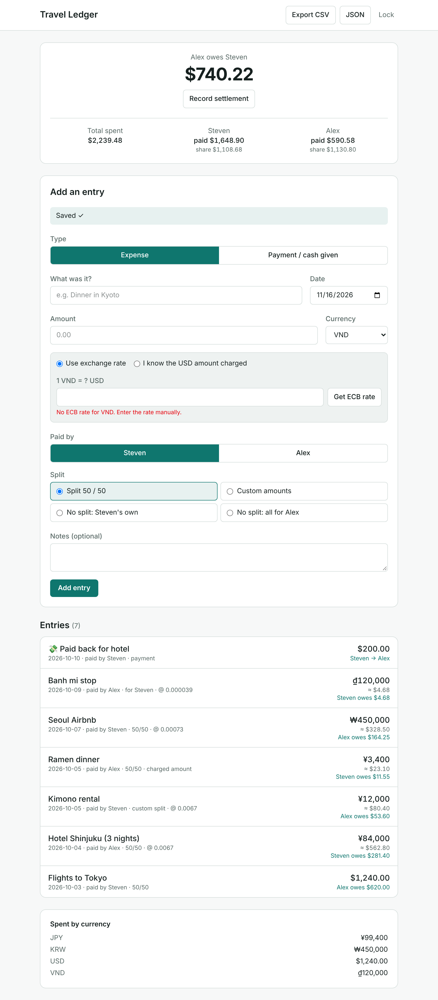
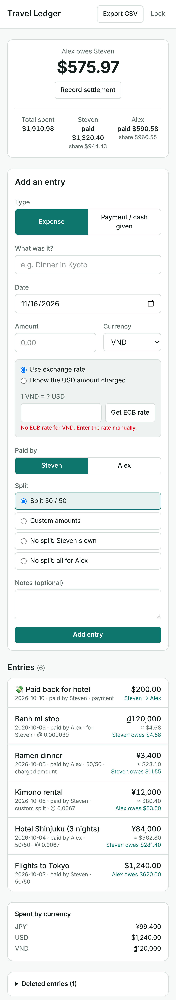
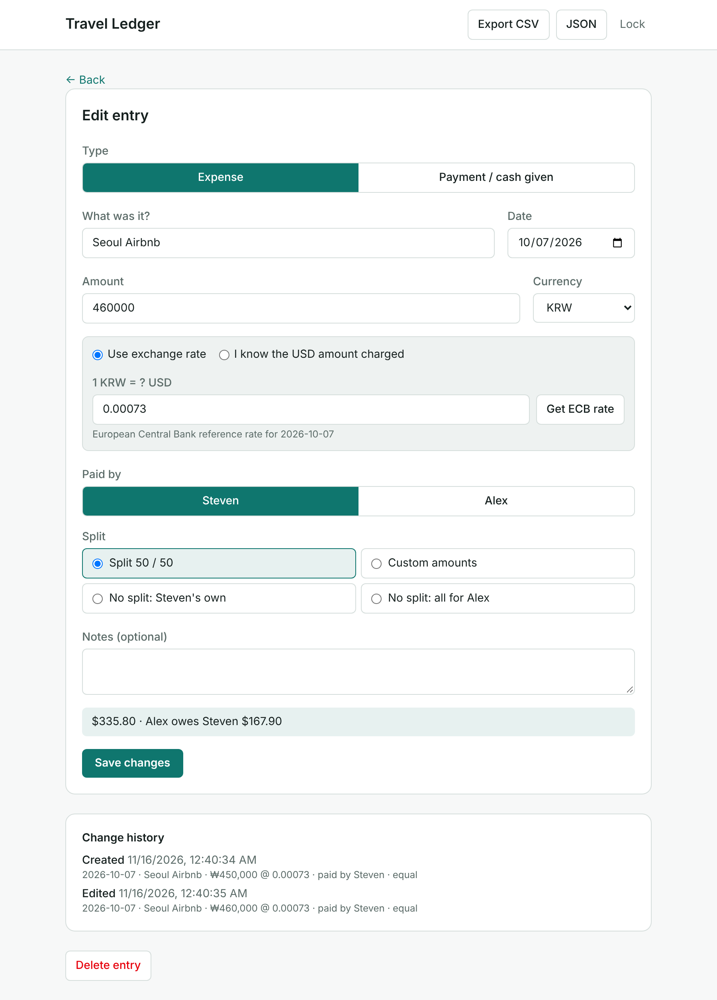

# Travel Ledger

A small Next.js app for two people (Steven and a travel partner) to record shared expenses in any currency
and see who owes whom.

| Desktop | Phone | Edit + history |
|---|---|---|
|  |  |  |

## What it does

- **One form for everything.** Each entry has a description, date, amount and currency, who paid, and how it's split:
  - 50/50
  - custom amounts
  - not split, the payer's own (tracked, but nobody owes anything)
  - not split, all for the other person (they owe the full amount)

  There's also a **Payment / cash given** type for paying each other back.
- **Running balance.** The top of the page shows who owes whom in your home currency. **Record settlement** adds the
  payment that brings it to zero.
- **Editable.** Click any entry to change or delete it. Every create, edit and delete is kept in a change log, shown
  on the entry's page, and deleted entries stay listed, so you can see what changed when you reconcile.
- **Export.** **Export CSV** opens in Excel, Numbers or Google Sheets. It has one row per entry with the original
  amount, the rate used, the converted amount, each person's share and the running balance. **JSON** is a complete
  backup.
- **Password gate.** See [the password](#the-password) below.

## Handling multiple currencies

The app follows these practices, and they're also good rules if you ever reconcile by hand:

1. **Settle in one home currency.** Every balance is calculated in `HOME_CURRENCY` (USD by default). Pick it once and
   don't change it after you've added entries.
2. **Always record the original amount and currency** exactly as charged (¥84,000, not "$562.80"). The converted
   value is derived from it, so nothing is lost and you can check it against receipts.
3. **Freeze the rate at the time of the expense.** Each entry stores its own rate, the rate's source and the rate's
   date. Converting old expenses at today's rate would shift the balance every day, so it's never done.
4. **Use the rate from the transaction date.** The app looks up the European Central Bank reference rate for that
   date. On weekends and holidays there's no ECB rate, so it uses the previous business day and says so. The ECB
   covers about 30 major currencies. For others (e.g. VND) you type the rate in.
5. **Best of all, use what you were actually charged.** Pick "I know the USD amount charged" and enter the amount from
   your card or bank statement. That includes your bank's real rate and any foreign-transaction fees, so the split is
   exactly what left your account. The app works out the effective rate and stores the exact charged amount.
6. **Never use floating-point numbers for money.** Amounts are stored as whole cents (or whole yen, since some
   currencies have 0 or 3 decimals). Rates are exact decimals, and each conversion rounds only once, at the end.
   When a 50/50 split leaves an odd cent, it stays with the payer, so nobody is ever charged more than half.
7. **Settle in one currency at the end.** Pay the balance in the home currency and record it as a payment or with
   **Record settlement**.

## The password

You suggested a password field whose answer is "Steven". That's a sensible way to keep bots out, with a few changes:

- **Asked once per device, not on every entry.** The password unlocks the whole app, including viewing and
  exporting, not just the form. A bot or a stranger who finds the URL shouldn't be able to read your expenses either.
  After you enter it once, a secure cookie keeps that browser unlocked for 180 days. **Lock** signs that device out.
- **Checked on the server, never in the page's code.** A check in the browser could be read or skipped by any bot.
  Every page, form action and API call verifies the cookie.
- **Not case-sensitive**, so "steven" from a phone keyboard works.
- **Changeable without code.** Set `APP_PASSWORD` in your hosting settings. Changing it signs out every device.
- **Extra bot defenses:** a hidden "honeypot" field that only bots fill in, a one-second delay after a wrong
  password, and `noindex` plus `robots.txt` so search engines don't list the site.

This is a speed bump, not real security. Anyone who knows or guesses the password gets in. That's fine for a shared
travel ledger, but use something less guessable than a name if the URL will be shared widely.

## Running it locally

```bash
npm install
cp .env.example .env.local   # then edit names, password and home currency
npm run dev                  # http://localhost:3000
```

Locally, data is stored in `data/ledger.db` (a SQLite file).

Other commands: `npm test` (unit tests for the money and balance logic), `npm run lint`, `npm run build`.

## Deploying (Vercel + Turso, both free for this size)

Vercel has no permanent disk, so production needs a hosted database. Turso is hosted SQLite and works with the
same code.

1. Create a database at [turso.tech](https://turso.tech), then copy its URL (`libsql://…`) and create an auth token.
2. Import this repository in [Vercel](https://vercel.com/new).
3. In the project's environment variables, set:
   - `DATABASE_URL` and `DATABASE_AUTH_TOKEN` (from Turso)
   - `APP_PASSWORD`
   - `PERSON_1_NAME` and `PERSON_2_NAME`
   - `HOME_CURRENCY`
4. Deploy. Tables are created automatically on first use.

It runs on any Node.js host too. On a server with a disk you can keep the default `file:` database and skip Turso.

## Settings

| Variable | Default | Meaning |
|---|---|---|
| `APP_PASSWORD` | `Steven` | Shared password (case-insensitive) |
| `PERSON_1_NAME` / `PERSON_2_NAME` | `Steven` / `Partner` | Names shown in the app |
| `HOME_CURRENCY` | `USD` | Currency balances are settled in |
| `DATABASE_URL` | `file:data/ledger.db` | libSQL/SQLite database |
| `DATABASE_AUTH_TOKEN` | | Token for a hosted database |
| `RATES_API_BASE` | `https://api.frankfurter.dev/v1` | Exchange-rate service (ECB data, no key needed) |
